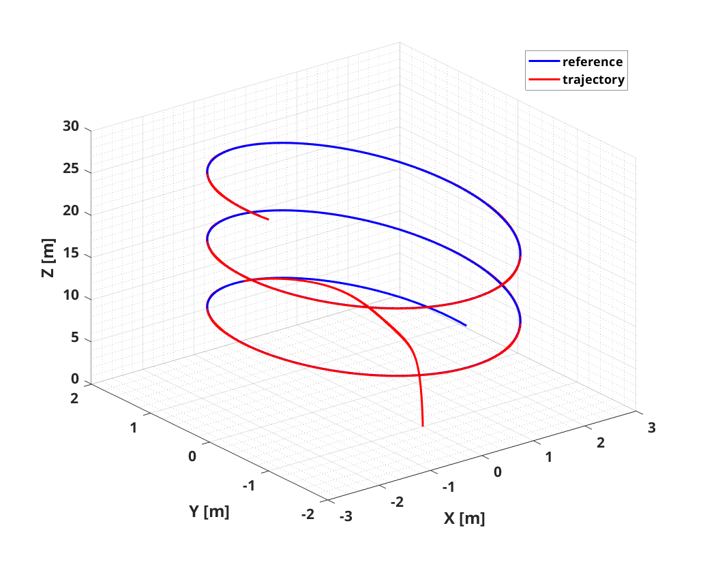
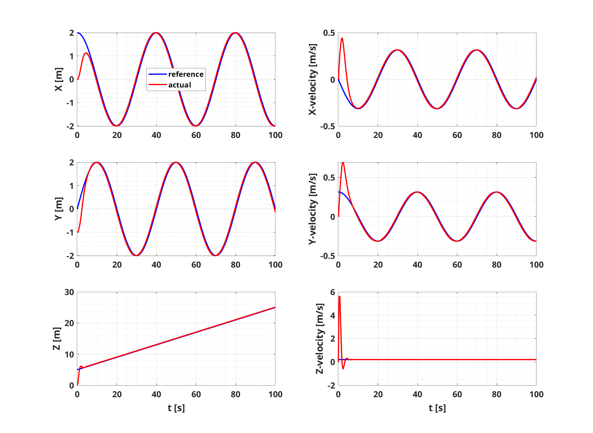

# Quadrotor Control with a Linear Parameter-Varying MPC

A MATLAB simulation of a quadrotor that follows 3-D reference trajectories using a two-rate cascaded controller:

- **Position loop** (slow): PD control with acceleration feedforward, converted in closed form into a thrust command and roll/pitch references.
- **Attitude loop** (fast): a model predictive controller whose prediction model is linear parameter-varying in the body rates and the rotor spin sum. It is unconstrained, so each step is a single linear solve.
- **Plant**: full nonlinear 12-state rigid-body model with rotor mixer, gyroscopic coupling and optional quadratic drag, integrated with RK4.

The write-up with derivations, algorithm and the results for all nine trajectories is in [`report/report.pdf`](report/report.pdf) (LaTeX source: [`report/report.tex`](report/report.tex)).

<p align="center">
  
  
</p>

## Quick start

```matlab
cd quadrotor-lpv-mpc
main
```

Open `main.m` and set the options at the top:

| Option | Meaning |
|---|---|
| `cfg.trajectory` | `1` ... `9` for one trajectory, or `'all'` to run every trajectory |
| `cfg.drag.enabled` | aerodynamic drag on/off |
| `cfg.animate`, `cfg.layout` | 3D animation and its panel layout (single trajectory only) |
| `cfg.showPlots` | open the figures on screen (single trajectory only) |
| `cfg.saveFigures` | write figures and tables to `report/figures` |

A single trajectory prints its metrics, animates the flight, shows the figures and saves them as `trajN_*.png`. With `'all'` every trajectory is simulated without display, all figures are saved, and the summary table and an error overview figure are written as well. All vehicle data and tuning values are in `src/defaultSettings.m`.

## Building the report

`report/` is a self-contained LaTeX project. Running `main` with `cfg.trajectory = 'all'` fills `report/figures/` with every figure and table the report uses. Compile `report/report.tex` (or upload the whole `report` folder to a LaTeX editor) and the report is built from those files, so the report follows whatever the simulation produced.

## Layout

| Path | Purpose |
|---|---|
| `main.m` | Options and entry point |
| `src/defaultSettings.m` | Vehicle, controller and scenario parameters |
| `src/buildReference.m` | The nine reference trajectories (position, velocity, acceleration, yaw) |
| `src/runScenarios.m` | Run one trajectory or all nine, print metrics, save outputs |
| `src/runSimulation.m` | Closed-loop simulation |
| `src/positionCommand.m` | Position loop: errors to thrust and roll/pitch references |
| `src/attitudeIncrement.m` | LPV model, prediction and MPC solution |
| `src/vehicleDerivatives.m`, `src/rk4Step.m` | Plant dynamics and integration |
| `src/rotorMixer.m`, `inputsFromSpeeds.m`, `speedsFromInputs.m`, `spinSum.m` | Rotor-to-input mapping |
| `src/rotationMatrix.m`, `eulerRates.m`, `worldVelocity.m` | Frames and kinematics |
| `src/summarizeRun.m`, `src/writeSummary.m` | Tracking and actuation metrics, CSV and LaTeX table |
| `src/plotResults.m`, `src/plotErrorOverview.m`, `src/styleFigure.m`, `src/savePng.m` | Figures |
| `src/animateFlight.m` | 3D animation (two layouts) |
| `report/` | LaTeX report and its `figures/` folder |

## Trajectories

1. Helix, constant radius and climb rate
2. Circle, then a straight run with constant climb
3. Circle, then a straight run with quadratic climb
4. Circle, then a straight run with sinusoidal climb
5. Helix with linearly growing radius
6. Helix with quadratically growing radius
7. Straight diagonal run
8. Weaving path with constant climb
9. Circle with oscillating altitude

Metrics for all nine are in `report/figures/trajectory_summary.csv`.

## Notes

- The attitude controller has no constraints, the prediction model assumes small angles, and the position loop uses perfect state feedback. The report's limitations section lists these in full.

## Acknowledgment

Inspired by Mark Misin's thesis *Model Predictive Controller of a UAV using the LPV approach* (UPC, 2020) and his course material, and by the quadrotor model of Carlos Trapiello Fernández (UPC, 2018).
